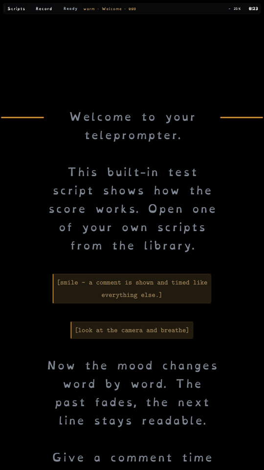

# Teleprompter_Vk

A Vulkan/Wayland teleprompter for Linux, ported from the Python/GTK4
[`teleprompter`](../teleprompter) project. The script is a strict timing score;
the presenter sees a fullscreen scrolling read while `ffmpeg` records the camera
and microphone **without ever compositing the script into the video**.

This repository is deliberately organised like the other minervarr desktop
projects (Matrix_Player, Klend-ario): a small portable core, a Vulkan frontend,
first-party framework submodules, and the original Python implementation kept
in `prototype/` as the behavioural reference.


## Build

Requirements (Arch names in parentheses):

- CMake ≥ 3.22 and Ninja
- a C++17 compiler
- Vulkan loader + headers (`vulkan-icd-loader`, `vulkan-headers`)
- Slang compiler (`slangc`, in the Vulkan SDK)
- Wayland client/cursor, xkbcommon, protocols + scanner (`wayland`,
  `wayland-protocols`, `xkbcommon`)
- `ffmpeg` / `ffprobe`

```sh
git submodule update --init --recursive
./scripts/build.sh                  # Debug into build/ (tests included)
./scripts/verify.sh
```

`scripts/build.sh` is the friendly front end: a stdlib-only Python zipapp
(`scripts/teleprompter_builder.pyz`) around cmake + ninja. On a terminal it
offers the build type; otherwise it builds Debug.

```sh
./scripts/build.sh build --release   # Release into build_release/ (no tests)
./scripts/build.sh build --no-gui    # portable core + tests only
./scripts/build.sh --version
./scripts/build.sh build --dry-run
```

It probes for `slangc` (or `$VULKAN_SDK`) and the Wayland/xkb development files,
enables the window automatically when they are present, and falls back to a
core-only build when they are not; `--gui` forces it and `--no-gui` skips it.
Tests are Debug-only. The direct cmake recipe is equivalent:

```sh
cmake -S . -B build -G Ninja -DCMAKE_BUILD_TYPE=Debug
cmake --build build
ctest --test-dir build --output-on-failure
```

The executable lands at `build/gui/teleprompter` (or
`build_release/gui/teleprompter`); shaders, fonts and the bundled test score are
copied beside it automatically. Run it from anywhere:

```sh
./build/gui/teleprompter                 # library, fullscreen on the current output
./build/gui/teleprompter my-score.txt    # open a score fullscreen on the current output
./build/gui/teleprompter --windowed my-score.txt
./build/gui/teleprompter --output DP-2 my-score.txt  # or any Wayland connector
```

`scripts/run.sh` runs an existing build (Debug preferred, then Release) or
builds Debug first.

## Command line

```
teleprompter [script] [--line PCT] [--output CONNECTOR] [--font FACE]
             [--device DEV] [--audio SRC] [--size WIDTHxHEIGHT] [--fps N]
             [--windowed]
teleprompter --print-timing [--words] [script]
teleprompter --check
```

- `--print-timing` validates a score and prints paragraph starts and the summed
  total; it exits 1 and names the source line when timing is incomplete.
- `--words` adds every word/comment/pause to that dump.
- `--check` opens the camera and microphone for one second each and exits
  non-zero on failure.
- `--size` must be an even `WIDTHxHEIGHT`; `1280x720` is the recording default.
- `--output` selects the Wayland connector for the fullscreen window (for
  example `DP-2`). With no `--output`, the compositor chooses the current
  output. A purely windowed surface cannot be positioned by a Wayland client,
  so use fullscreen/`--output` when the monitor matters.
- `--font` chooses `newcm` (the default New Computer Modern Sans), `opendyslexic`,
  or a path to an `.otf`/`.ttf` file or a directory of faces. The choice is
  remembered in `$XDG_STATE_HOME/teleprompter/settings.json`, whether it came
  from the in-app menu or from `--font`.

There is intentionally **no `--duration`**: the total is the sum of the
authored word times.

### Development switches

These exist for automated verification and are not part of the user contract:

```
--capture out.ppm   render 6 frames, write the last one as a PPM, exit
--seek SECONDS      start the read at a clock position
--autoplay          start scrolling immediately
--record-test N     record N seconds, finalize, exit
--demo-help         open the key map on the first frame
--demo-picker       open the built-in file picker on the first frame
--demo-font         open the font menu on the first frame
```

## The score

See [`prototype/skills.md`](prototype/skills.md) for the full authoring guide.
The short form:

```text
{warm: Welcome}[0.45]Welcome [0.35]to [0.30]your [0.35]teleprompter.

[1.0] [smile — a comment is shown and timed like everything else.]

[0.30]Every [0.30]displayed [0.30]word [0.30]needs [0.30]a time.
```

- `[seconds]` before a word/comment is its duration; the prefix is stripped.
- A paragraph containing only mood tags is a header and needs no time.
- `[2.0]` alone is a silent beat.
- `[mm:ss]` anchors, zero durations, and bare comments are hard errors.
- `{mood}`, `{mood: Theme}`, and `{#rrggbb}` persist until changed.
- `**bold**` and `*italic*` still work.

## Keys

| Key | Action |
|---|---|
| Space | Start / pause; at the end, restart from the top |
| R | Start / stop recording |
| Ctrl+R | Return to the library (refresh it there) |
| Ctrl+O | Open another script |
| F / F11 | Toggle fullscreen; Esc leaves it |
| Up / Down | Move the reading line by 2 % (Shift+Up/Down is the same) |
| C | Cycle the reading line (15 / 25 / 35 / 50 %) |
| A | Centred / flush-left text |
| K | Word-by-word karaoke fill |
| M | Mood colours |
| T | Choose the script font |
| Left / Right | Nudge the scroll position |
| Home / End | Jump to the top / bottom |
| F5 or L | Reload the current script |
| H | Show / hide the HUD and section timer |
| ? or F1 | Show the key map |
| Ctrl+Q | Quit, finalizing any recording first |

## Fonts and text quality

OpenDyslexic is available next to New Computer Modern. Press **T** — or click
the **Font: …** button in the library — to choose. Every screen and every piece
of text uses the selected face, including stage directions and comments.
OpenDyslexic is wider, so its preset uses a 0.70 size factor to keep a
comparable amount of text per line.
It also lacks em dash, ellipsis and arrow glyphs; those fall back to New
Computer Modern per style instead of disappearing.



The text engine path is **RasterFont**, not MTSDF: it rasterizes the actual
Bézier outlines with FreeType at the exact pixel size (8-bit coverage, with
subpixel phases for small text). That is the highest-quality path for this
fixed-size UI and is what the app already uses. MTSDF is a different trade-off
for continuously scaled text; it would be softer at the 11–16 px HUD sizes, so
it is not the default.

## What is in here

```
core/                     portable C++17 timing, colours, recents, recorder
gui/                      Vulkan/Wayland window, text layout, karaoke renderer
tests/                    stdlib-style assert tests for the pure core
libs/firstparty/framework/App_shell              submodule
libs/firstparty/framework/Vk_Canvas_Lb_LAW       submodule
assets/fonts/             New Computer Modern, OpenDyslexic and mono faces
samples/test-script.txt   built-in, read-only demo score
prototype/                the original Python app, samples, tests and docs
docs/                     screenshot, porting notes and roadmap
scripts/                  build / run / verify helpers
```

### Engine use

- **`Vk_Canvas_Lb_LAW`** supplies the renderer, SDF shape pipeline, wayland
  platform backend, RasterFont/MSDF text paths, and the `Canvas` immediate-mode
  primitives.
- **`App_shell`** supplies the `Host`/`AppView` seam, the raw-Wayland host,
  paths, and the log-file bootstrap.
- The nested **`vulkan_font_engine`** (with FreeType and msdfgen) is what turns
  the shipped OTF faces into the per-size glyph cache the renderer uploads.
- The original Python/GTK app is **not linked or run** by the C++ binary.

The app calls small additions to the framework: `Host::setFullscreen()`,
`WindowOptions::output` (Wayland connector selection), a console-restore helper
for CLI modes without a TTY, and an optional extra fd in
`WaylandDisplay::dispatch()` so the 16 ms scroll timer is not paced by the
display's idle timeout. They live on the framework repositories' `main`
branches; the submodule commits pinned here are the exact build inputs, so a
plain `git submodule update --init --recursive` reproduces the build with no
patch step.

## Why the port looks different from the GTK app

GTK/Pango did four jobs the Vulkan path has to do explicitly:

1. **Word wrapping and line measurement** — `gui/src/layout.cc` builds lines
   from measured word widths, and records every glyph's line and clock.
2. **Per-character colouring** — Pango attributes become per-glyph vertex
   colours emitted through the same RasterFont atlas.
3. **Widgets** — the HUD, cards, section timer, help card and file picker are
   immediate-mode shapes, text and hit rectangles redrawn each frame.
4. **Scrolling** — a word-knot `Timeline` maps script seconds to pixels; the
   last line lands on the reading line at full weight.

The timing model, parser, section timer, karaoke maths and formatting are direct
ports of the Python code; see `docs/PORTING.md` for the module map and the
behavioural checks.

## Recording

The command is the verified one from the Python app:

```sh
ffmpeg -hide_banner -loglevel error -nostats \
  -f v4l2 -input_format mjpeg -video_size 1280x720 -framerate 30 -i /dev/video0 \
  -f pulse -i default \
  -c:v libx264 -preset veryfast -crf 23 -pix_fmt yuv420p \
  -c:a aac -b:a 160k -movflags +faststart -y OUT.mp4
```

Stop writes `q` to ffmpeg's stdin; the recorder falls back to SIGTERM/SIGKILL
only after timeouts. Takes live in `recordings/` beside the executable, named
`YYYY-MM-DD_HHMMSS.mp4`.

## Tests

```sh
ctest --test-dir build --output-on-failure      # C++ core (Debug only)
./scripts/test_builder.sh                       # the build tool itself
./scripts/verify.sh                             # everything below
```

`./build/tests/teleprompter_core_tests` can still be run directly. A Release
configure produces no test targets.

`scripts/verify.sh` builds Debug, runs CTest and the builder's tests, builds the
bundled Python archive, checks its test suite, runs `--print-timing` on the
sample, compares the totals, and runs the Vulkan capture on the sample score
when a Wayland session is available.

## License

AGPL-3.0-or-later, matching the framework submodules. See `LICENSE`.
